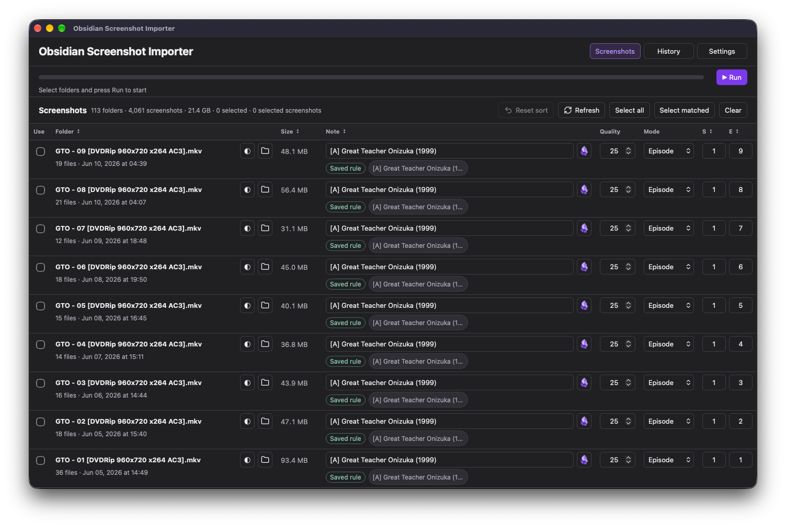

# Obsidian Screenshot Importer

Map image folders to Obsidian notes, then batch-import with compression,
episode organization, and rollback.

A standalone macOS app for reviewing batches before adding them to an Obsidian vault.
Images can come from any player, game, or other source.

[Download](https://github.com/theambinder/obsidian-screenshot-importer/releases/latest)
· [Changelog](CHANGELOG.md)

[](https://buymeacoffee.com/ambinder)



## Get Started

Requires **Apple Silicon (M1 or later)** and **macOS 13.5 or later**.

1. Download the Apple Silicon ZIP from [Releases](https://github.com/theambinder/obsidian-screenshot-importer/releases).
2. Extract it in Downloads and move **Obsidian Screenshot Importer.app** to Applications.
3. Open the app and select locations in **Settings > Choose Folders...**:
   screenshots, Obsidian vault, Media, and history/settings.
4. Review the suggested notes and episodes, select folders, and press **Run**.
5. Close the main window or press **Cmd+Q** to stop the app and its local service.
   An active operation finishes before shutdown.

The main ZIP contains only **Obsidian Screenshot Importer.app**, including Node.js,
cwebp, FFmpeg, and the HDR JXR decoder; no separate installation is needed. The optional
[Sources archive](https://github.com/theambinder/obsidian-screenshot-importer/releases/latest)
is a separate release asset with corresponding FFmpeg/WebP/AOM/zimg/jxrlib sources and build materials.
FFmpeg is distributed under LGPLv2.1; license notices remain inside the app.
Image processing works offline. Optional update checks contact GitHub only when requested.
The app is ad-hoc signed, not notarized; macOS may require
approval in System Settings > Privacy & Security when opening a downloaded copy.
See [PORTABLE-APP.md](PORTABLE-APP.md) for installation and transfer details.

## Features

- Scan source subfolders and suggest matching notes. Search by category and title,
  correct matches, and reuse saved mappings across similar folders.
- Detect seasons and episodes, including episode zero. Change Work/Episode for all
  folders sharing a Note, with remembered per-note mode and individual number detection. Keep episodes in numeric
  order, reuse padded/commented headings, and preserve existing note text.
- Convert to WebP, JPEG, PNG, AVIF, or keep SDR originals. Preserve filenames;
  preview original/converted images and detail crops before applying quality.
- Choose Original, 720p, 1080p, 1440p, or 4K output resolution, without distortion or
  upscaling. Review estimated folder/image sizes from a small cached sample before importing.
- Convert HDR JXR captures to 10-bit 4:4:4 PQ AVIF. Select JXR only (default), PNG only,
  or Both for same-name pairs; archive and restore all originals, including unconverted counterparts.
- Set category defaults and per-note quality; convert batches in parallel.
- Insert Obsidian embeds into the correct work or episode section and place images
  in the configurable **Settings > Image Folder** (default `All Notes/Attachments/{notename}/`).
- Review run summaries, compression savings, and archived sources. Roll back a
  whole run or one folder with live progress, or send checked archives to the macOS Trash.
  A second mutation cannot start while rollback is running; progress survives tab changes and page reloads.
- Select matching notes in bulk, sort by Folder, Size, Note, Season, or Episode, and use system/light/dark themes.
  Each section remembers its own scroll position during the session.
- Preserve note creation dates on macOS while updating modification dates.

## Folder Layout

Source images must be inside subfolders of the selected screenshots root. Folder
names identify a work or episode, for example:

```text
Screenshots/
  Example Movie (2025)/
    screenshot-01.png
  Example.Show.S02E03/
    screenshot-02.png
```

The selected Media folder must be inside the vault and contain the supported note
categories: **Anime, Movies, Series, Cartoons, Games, Manga, Comics**. Notes outside
these categories are not edited. Missing notes are created manually in Obsidian.

Processed originals move to `Screenshots/_archive/<run>/`. Originals should be retained
until the result has been checked. History, rollback backups, mappings, and preferences are stored
in the separate data folder, which is excluded from Git and release archives.
Sharing that folder between Macs requires the same paths for old rollback history;
use one Mac at a time and let synchronization finish before switching.

## Resolution, Estimates, and Ordering

The default order is the source **folder's Date Modified**, newest first, matching
Finder. It is not the date of the newest screenshot inside the folder. **Reset sort**
restores this order; Refresh retains an explicitly selected column sort.

**Resolution** defaults to **1080p or smaller**. Presets fit the corresponding 16:9 bounds,
rotate the bounds for portrait images, preserve aspect ratio, and never enlarge a
smaller source. Settings stores the default; changes in the table apply to matching
Note rows. Original/copy format does not resize SDR files. JXR always uses HDR AVIF
and can be resized even when the regular-image default is Original.

1080p is a maximum fitting box, not a forced aspect ratio: 3140×2200 becomes
approximately 1541×1080, while 1280×720 stays unchanged. The table shows sampled
source dimensions in pixels below Resolution; its tooltip and the converted preview
show the exact output dimensions. No cropping or stretching is applied. Original
keeps full dimensions when explicitly selected. Existing saved resolution choices
are retained.

Output sizes marked **≈** are estimates based on at most two actual sample encodes
per folder/settings combination, not guarantees. Only visible folders are processed
in the background, one estimate at a time. Results and samples are cached, and
background estimation stops during import, rollback, Trash, or shutdown. Preview
shows folder/image estimates and exact sizes for already converted samples. Apply
Settings applies the preview's quality, format, effort, and resolution to matching
Note rows; paired-source selection remains per folder. Estimates describe selected
outputs, whereas archive totals include all originals, including omitted counterparts.

## HDR Captures and Paired Originals

Floating-point linear scRGB `.jxr` captures are converted to HDR AVIF, regardless of
**Default Format**. Ordinary PNG/JPEG images still use that default. The AVIF quality
scale runs from 1 to 100; **Quality 40 = CRF 16**. Lower CRF preserves more detail.
Compression Preview shows the actual CRF, HDR reference, converted image, and file sizes.
Category quality defaults and per-note overrides are retained; HDR does not reset them.

**Settings > JXR / PNG Pairs** sets the default for files sharing a basename in the
same folder. Compression Preview can override it for an individual folder. The choice
affects paired files only, not unrelated or unpaired images. With **Both** and AVIF output,
the PNG counterpart uses `.sdr.avif` to avoid overwriting the HDR `.avif`.

Every source file moves to the archive after a successful import. **Trash** includes
unconverted counterparts, and **Rollback** restores them. Keep archives until the
imported images have been checked. Originals are never deleted during conversion.

HDR appearance depends on the display, macOS, and image viewer. The JXR reference is
rendered as 16-bit PQ PNG because WebKit cannot decode JXR directly; it is not an SDR
tone map. No extra brightness compensation is baked into AVIF. Integer, transparent,
and ICC-tagged JXR files are rejected rather than silently misinterpreted as scRGB.

## Updates

Open **Settings > Update** or the application menu's **Check for Updates...**.
The Updates window lists published stable GitHub releases and their changes.
**Download Update** downloads the latest compatible Apple Silicon release and checks
its size and SHA-256 digest. **Install and Restart** validates the application bundle,
replaces the closed app, and reopens it. Settings, history, and vault files remain unchanged.

Installation requires a writable local application folder. Downloaded or translocated
copies must be moved to Applications first. An active import, rollback, or archive operation
must finish before downloading or installing an update. No background update checks,
GitHub account, telemetry, or automatic installation are used.

Versions before 1.5.0 require one manual installation of a release with the updater.

## Development

Clone the repository on an Apple Silicon Mac with Apple's Command Line Tools and
CMake, pkg-config, autoconf, automake, and GNU libtool available for codec builds:

```sh
git clone https://github.com/theambinder/obsidian-screenshot-importer.git
cd obsidian-screenshot-importer
/bin/bash scripts/build-macos-app.sh
```

The build downloads checksum-pinned Node.js, WebP, FFmpeg, AOM, zimg, and jxrlib sources/distributions and
bundles the required executables. Build tools are not required on destination Macs.
The JavaScript application has no npm dependencies. Production launch is through
the built application, not a standalone browser service or legacy launcher.

The source test suite requires Node.js 20+, `cwebp`, and a full FFmpeg installation
with the `lavfi` input used to generate fixtures. These development tools must
precede the bundle's minimal FFmpeg on `PATH`. The portable integration test
separately exercises the bundled executables without external dependencies.

```sh
npm test
```

Tests use disposable fixtures. Building on Apple Silicon creates the app and a
versioned app-only ZIP in `dist/`, plus a separate corresponding-sources ZIP.
Build the bundle before running its integration test; otherwise that test skips.
User data, dependencies, temporary builds, generated apps, and releases are ignored.

## Documentation

- [PROJECT.md](PROJECT.md): detailed requirements, architecture, matching rules,
  Markdown insertion, archive/rollback behavior, and implementation decisions.
- [PORTABLE-APP.md](PORTABLE-APP.md): macOS build, lifecycle, locations, and transfer.
- [PERFORMANCE.md](PERFORMANCE.md): size and conversion measurements.
- [AUDIT.md](AUDIT.md): prior code audit and fixes.
- [CHANGELOG.md](CHANGELOG.md): complete release history.

The project currently has no project-wide license. Bundled dependencies and icons
retain their own license notices. This is an independent tool, not an official
Obsidian product.
